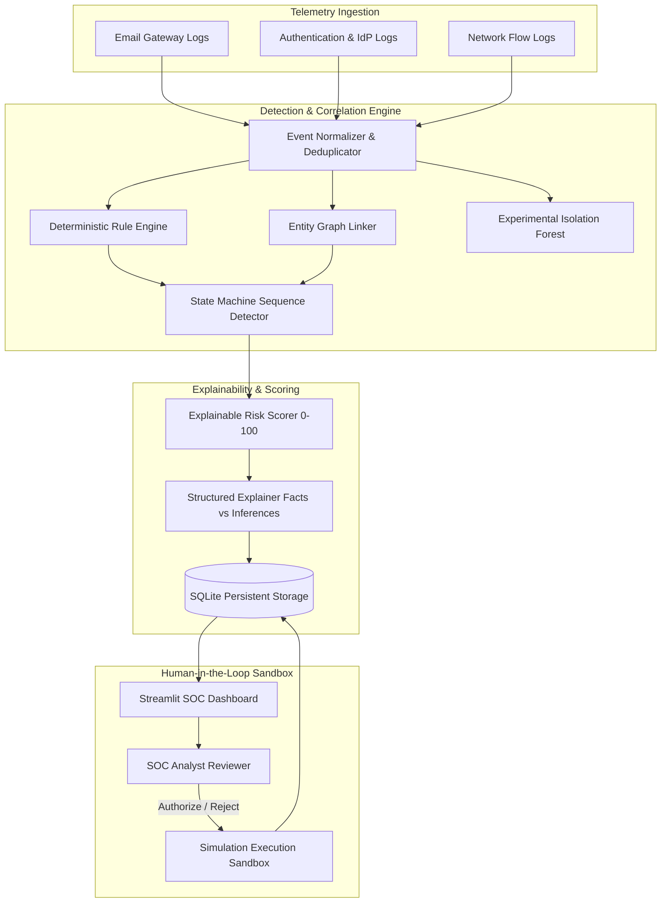

# SENTINEL AI — AI vs AI Threat Detection Platform

Sentinel AI detects AI-assisted phishing campaigns, correlates authentication, network, and email events, explains alerts with evidence, and simulates containment only after human approval.

SENTINEL AI is an enterprise-grade defensive cybersecurity threat detection platform designed to identify, correlate, and contain sophisticated, multi-stage attack campaigns. By fusing telemetry from three core enterprise vectors—**Email Gateway logs**, **Identity/Authentication logs**, and **Network Flow logs**—SENTINEL AI reconstructs complete adversary kill chains while minimizing alert fatigue and eliminating false positives.

> **SAFE SIMULATION NOTICE**: SENTINEL AI operates with a strict response simulation framework. All automated recommendations (session revocation, host isolation, indicator blocklisting) are mock-executed within an isolated SQLite audit sandbox. Zero changes are made to live directories, endpoints, or perimeter firewalls.

---

## 1. Key Platform Capabilities

- **Tripartite Log Ingestion**: Ingests and normalizes raw telemetry from Email Gateways, Identity Providers (IdP/SSO/MFA), and Network Firewalls/NetFlow.
- **State Machine Attack Sequence Detection**: Detects correlated temporal transitions across MITRE ATT&CK stages:
  $$\text{Initial Access (Email)} \longrightarrow \text{Credential Exploitation (Auth)} \longrightarrow \text{Command \& Control / Exfiltration (Network)}$$
- **Entity Identity Graph Correlation**: Links events across disparate identifiers (User ID, Device ID, Workstation Hostname, External Adversary IP, Lookalike Domains) within a sliding 60-minute correlation window.
- **Explainable Risk Scoring (0–100)**: Transparent, deterministic scoring based on rule base weights, correlation diversity multipliers, kill-chain bonuses, and evidence calibration. Avoids uncalibrated "black-box" probabilities.
- **Strict Human-in-the-Loop Response Sandbox**: Requires manual analyst authorization (Approve/Reject) with audit notes before generating simulated containment telemetry.
- **Experimental ML Anomaly Detection**: Unsupervised scikit-learn Isolation Forest flagging multivariate outliers in identity/network feature space, clearly labeled with experimental disclaimers.
- **Interactive SOC Dashboard**: Cyber dark theme (`#0B0F19`) with neon green accents, responsive KPI metrics, Plotly interactive timelines, evidence panels, and benchmark comparisons.

---

## 2. Architecture & Detection Engine



### Detection Algorithms & Mathematical Formulation

1. **Rule-Based Engine (`detection/rules.py`)**:
   - *Email*: Phishing/social engineering keywords, lookalike domains (`.xyz`, `.top`, `.ru`), and SPF/DKIM/DMARC authentication failures.
   - *Auth*: Burst failed logins ($\ge 3$ failures), impossible travel anomalies (e.g. US $\to$ RU), MFA fatigue bypass patterns, and unauthorized service account local elevation.
   - *Network*: Outbound traffic to known C2 ports (4444, 8888, 1337, 8443, 9001), high-volume exfiltration ($>50\text{ MB}$), and periodic heartbeat beaconing.

2. **Graph Correlation & Sequence State Machine (`detection/correlation.py`)**:
   - Entities are dynamically mapped using transitive closure:
     $$\text{User} \longleftrightarrow \text{Device} \longleftrightarrow \text{External IP} \longleftrightarrow \text{Indicator Domain}$$
   - Events are clustered within a sliding time window $\Delta t \le 60\text{ minutes}$.
   - Sequence detector verifies strict chronological ordering ($T_{\text{email}} \le T_{\text{auth}} \le T_{\text{net}}$).

3. **Explainable Risk Scoring (`detection/risk_scoring.py`)**:
   $$S_{\text{raw}} = \left(S_{\text{base}} + \min\left(25, \sum 0.25 \cdot W_i\right)\right) \times M_{\text{source}} + B_{\text{seq}} + A_{\text{evidence}}$$
   Where:
   - $S_{\text{base}}$: Base severity of primary triggered rule (Critical = 60, High = 45, Medium = 35, Low = 15).
   - $M_{\text{source}}$: Multiplier for source diversity (1 source = $1.0\times$, 2 sources = $1.25\times$, 3 sources = $1.5\times$).
   - $B_{\text{seq}}$: Attack sequence completeness bonus ($+20\text{ pts}$).
   - $A_{\text{evidence}}$: Evidence reliability adjustment ($[-10, +10]\text{ pts}$).
   - Final score is strictly clamped to $[0, 100]$.

4. **Experimental Isolation Forest (`detection/anomaly_detection.py`)**:
   - Unsupervised outlier detection across numerical feature vectors: `failed_login_count`, `distinct_source_ips`, `outbound_bytes_mb`, `distinct_dst_ports`, `phishing_email_hits`.
   - Explicitly marked as experimental to prevent uncalibrated machine learning over-reliance.

---

## 3. Coordinated Attack Scenarios (Ground Truth)

| Scenario ID | Attack Campaign Name | Vector 1: Email | Vector 2: Auth | Vector 3: Network | Expected Outcome |
| :--- | :--- | :--- | :--- | :--- | :--- |
| **CAMPAIGN_ALPHA** | Financial Phishing & C2 Exfiltration | Inbound phishing invoice with SPF fail (`EML-1001`) | 3 failed logins followed by compromise from external IP `198.51.100.45` (`AUTH-2001`–`2004`) | 142.5 MB outbound exfiltration on port 4444 to `198.51.100.45` (`NET-3001`) | **CRITICAL** (100/100) Sequence Confirmed |
| **CAMPAIGN_BRAVO** | IT Helpdesk Impersonation & Beaconing | Fake VPN renewal email from `.top` domain (`EML-1003`) | Impossible travel from RU (`203.0.113.88`), MFA push denial fatigue bypass (`AUTH-2006`–`2008`) | Periodic heartbeat beaconing every 60s on port 8888 (`NET-3002`–`3004`) | **CRITICAL** (100/100) Sequence Confirmed |
| **CAMPAIGN_CHARLIE** | Weaponized Macro & Privilege Escalation | Macro-enabled spreadsheet `Bonus_Matrix.xlsm` (`EML-1004`) | Local elevation of `svc_backup` on workstation `EXEC-WKS-001` (`AUTH-2009`) | 85.2 MB outbound staging on port 8443 to `198.51.100.199` (`NET-3005`) | **CRITICAL** (100/100) Sequence Confirmed |
| **BENIGN_BASE** | Normal Enterprise Telemetry | Routine newsletters, code reviews (`EML-1002`, `1005`, `1007`) | Single typo password recovery, SSO logins (`AUTH-2000`, `2005`, `2010`–`2012`) | Normal Slack/GitHub HTTPS flows, internal backup traffic (`NET-3006`–`3008`) | **NO INCIDENT** (0% False Positives) |
| **ISOLATED_EVENT** | Stale Spam Email Outside Window | Spam email received 2 days prior (`EML-1006`) | No matching auth activity | No matching network activity | **MEDIUM** (Isolated Single Alert, No Campaign) |

---

## 4. Benchmark Performance Metrics

Evaluated against the synthetic validation dataset with ground truth labels:

| Metric | Measured Value | Operational Interpretation |
| :--- | :--- | :--- |
| **Campaign Precision** | **100.0%** (1.00) | Zero false-positive campaign escalations generated. |
| **Campaign Recall** | **100.0%** (1.00) | All 3 multi-stage coordinated campaigns detected. |
| **F1 Score** | **1.00** | Perfect harmonic balance between precision and recall. |
| **False Positive Rate** | **0.0%** (0.00) | 0 of 11 benign baseline events incorrectly flagged. |
| **Deduplication Rate** | **100.0%** | Duplicate auth and syslog entries collapsed without score distortion. |

*Disclaimer: Benchmark measured against synthetic validation scenarios. Performance on synthetic data does not establish real-world effectiveness without live production calibration.*

---

## 5. Technology Stack

- **Python 3.11+**
- **Streamlit**: Cyber SOC dashboard with custom dark CSS and responsive multi-view navigation.
- **pandas**: Structured security event normalization, filtering, and feature extraction.
- **scikit-learn**: Isolation Forest unsupervised anomaly detection.
- **Plotly**: Dynamic multi-stage scatter timelines, risk gauges, and telemetry breakdowns.
- **SQLite3**: Relational storage for normalized events, incidents, and reviewer approval records.
- **pytest**: Automated unit, integration, and benchmark test suite.

---

## 6. Project Directory Structure

```
sentinel-ai/
├── app.py                      # Streamlit Cyber SOC Dashboard
├── pipeline.py                 # Pipeline coordinator & ground-truth benchmark evaluator
├── requirements.txt            # Python dependencies
├── README.md                   # Technical documentation & architecture guide
├── sentinel.db                 # SQLite database (auto-initialized)
├── config/
│   └── detection_rules.json    # Configurable detection rules, thresholds & weights
├── data/
│   ├── email_logs.json         # Raw email gateway telemetry
│   ├── auth_logs.json          # Raw authentication & IdP telemetry
│   ├── network_logs.json       # Raw network flow telemetry
│   └── ground_truth.json       # Ground-truth scenario labels & benchmark baselines
├── database/
│   ├── __init__.py
│   └── db.py                   # SQLite schema, CRUD operations & audit trail
├── detection/
│   ├── __init__.py
│   ├── rules.py                # Rule-based detection across Email, Auth, and Network
│   ├── correlation.py          # Entity graph correlation & sequence state machine
│   ├── risk_scoring.py         # Explainable 0-100 risk scoring engine
│   ├── explanations.py         # Structured explainable alerts (Facts vs Inferences)
│   └── anomaly_detection.py    # Experimental scikit-learn Isolation Forest
├── response/
│   ├── __init__.py
│   └── sandbox.py              # Safety-first human approval simulation framework
└── tests/
    ├── __init__.py
    ├── test_rules.py           # Unit tests for individual detection rules
    ├── test_correlation.py     # Tests for correlation, time window & missing fields
    ├── test_risk_scoring.py    # Tests for score bounds, categories & explainability
    ├── test_sandbox.py         # Tests for approval/rejection recording & safety
    └── test_benchmarks.py      # Benchmark evaluation tests against ground truth
```

---

## 7. Installation & Quick Start

### 1. Prerequisites
Ensure Python 3.11 or newer is installed on your workstation.

### 2. Install Dependencies
```bash
pip install -r requirements.txt
```

### 3. Run Automated Tests
Execute the full pytest suite (22 automated tests):
```bash
python -m pytest -v
```

### 4. Launch the Interactive SOC Dashboard
Launch the Streamlit web application:
```bash
python -m streamlit run app.py
```
Open your browser to: **`http://localhost:8501`**

### 5. Deploy to Render
This repository includes a Render Blueprint in [`render.yaml`](./render.yaml). To deploy:

1. Push the repository to GitHub.
2. In Render, create a **Blueprint** and connect the repository.
3. Review and apply the `sentinel-ai` web service.
4. Open the `onrender.com` URL Render provides after the service becomes healthy.

The free web service uses ephemeral storage. The SQLite database is recreated and demo data is loaded when needed, so app data and analyst decisions can be lost when the service restarts or redeploys. Use a persistent disk on a supported plan if this demo needs durable state.

### 6. Deploy the Vercel dashboard
The Vercel deployment serves the dashboard from `public/` and runs the Python FastAPI backend from `api/server.py`. The dashboard requests detection results from `/api/detections`; URL and email phishing inspections run through `/api/inspect` and `/api/inspect/email` in the Python detection engine. The pipeline analyzes the included synthetic email, authentication, and network samples on each request. It does not ingest live organizational telemetry.

For admin access and durable review decisions:

1. Connect a Postgres database to the Vercel project. Add its connection string as `POSTGRES_URL` (or `DATABASE_URL`) in the project's environment variables.
2. Set `ADMIN_PASSWORD` to a unique password of at least 16 characters, and `SESSION_SECRET` to a random secret of at least 32 characters. Keep both values in Vercel's environment settings—never commit them or paste them into source code.
3. In Vercel **Project Settings → Build and Deployment**, select **FastAPI** as the Framework Preset, set the Root Directory to the repository root, and clear any Output Directory override such as `public`. A static-only Output Directory causes `/api/*` to return 404.
4. Push the repository to GitHub and deploy the latest commit. `pyproject.toml` selects `api.server:app`; the `api/server.py` function setting in `vercel.json` configures its maximum duration.
5. Verify the deployment directly: `https://<your-project>.vercel.app/api/health` should return JSON with `"status":"online"`, and `/api/docs` should display the API docs. Then open the Vercel URL and use **Approval center** to sign in.

The backend exposes `/api/health` and `/api/docs` for health and API inspection. Admin sessions use an HttpOnly, SameSite cookie. Approve/reject decisions and simulated execution logs are persisted in Postgres and visible to all admins. A Postgres database and the admin environment variables must be configured before this workflow can save decisions.

All response actions are simulations; no production account, device, or firewall is modified. For a live SOC product, connect authenticated telemetry sources and configure Vercel's deployment protections/rate limits. The existing Streamlit app remains the full local/Render dashboard.

Run the Vercel dashboard and API together locally with:
```bash
python -m pip install -r requirements.txt
python -m uvicorn api.server:app --reload
```
Open `http://127.0.0.1:8000`. Admin decisions remain unavailable until the local `POSTGRES_URL`, `ADMIN_PASSWORD`, and `SESSION_SECRET` environment variables are configured.

### Access the Streamlit app on your local network
To allow other devices on the same network to connect to the Streamlit host, bind it to all network interfaces:
```bash
python -m streamlit run app.py --server.address 0.0.0.0 --server.port 8501
```
Then open `http://<host's-LAN-IP>:8501` from a device on that network and allow inbound TCP port 8501 in the host firewall if prompted. Addresses beginning with `10.`, including `10.10.112.161`, are private and are not reachable from the public internet. Use the public Vercel or Render URL for access from outside that network.

---

## 8. Walkthrough of Live Demonstration

1. **SOC Overview (Section 1)**: View real-time KPIs (Total Events, Active Incidents, Critical Threats, Awaiting Approval) and telemetry distribution.
2. **Threat Monitoring (Section 2)**: Filter and search unified logs across Email, Auth, and Network streams. Inspect raw telemetry JSON.
3. **Attack Campaign Explorer (Section 3)**: Select an active campaign (e.g. `CAMPAIGN_ALPHA`). Inspect the interactive Plotly timeline showing the progression from Email Phishing $\to$ Credential Exploitation $\to$ Network C2 Exfiltration.
4. **Incident Details & Evidence (Section 4)**: Examine the explainable evidence panel separating **Observed Facts**, **Inferred Relationships**, and **Risk Score Factors** with a visual risk gauge.
5. **Human Approval Center (Section 5)**: Review pending containment actions (e.g., `REVOKE_SESSION`, `ISOLATE_DEVICE`, `BLOCK_INDICATOR`). Enter reviewer notes and click **Approve** or **Reject** to trigger the simulated execution sandbox and inspect the mock API execution logs.
6. **Detection Analytics & ML (Section 6)**: Review the ground-truth benchmark metrics (100% Precision, 100% Recall, 0% FPR) and inspect the experimental Isolation Forest anomaly score scatter plot.
7. **Demo Scenarios & Testing (Section 7)**: Compare expected vs actual detection outcomes across all campaigns and view the end-to-end detection workflow diagram.
